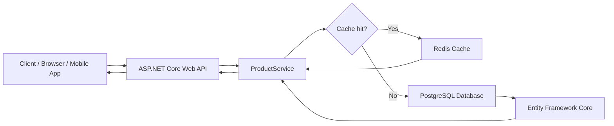
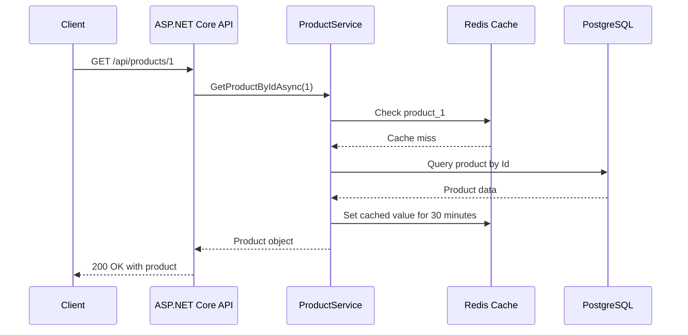

# Product API with Redis and PostgreSQL

A production-ready ASP.NET Core Web API for managing product data with PostgreSQL persistence and Redis caching. This project demonstrates a clean architecture for building fast, scalable, and maintainable backend services using C#, Entity Framework Core, PostgreSQL, and Redis.

<p align="center">
  
  
  
  
  
</p>

## Overview

This repository is designed to showcase how to build a high-performance REST API that combines:

- PostgreSQL for durable and relational data storage
- Redis for fast in-memory caching
- ASP.NET Core for REST API and business logic
- Entity Framework Core for database access
- Swagger for interactive API documentation

It is ideal for product catalog systems, e-commerce APIs, inventory management backends, and modern web applications that need speed and reliability.

## Why this project matters

Modern applications need a balance between performance and data integrity. This project demonstrates a practical pattern where frequently accessed data is cached in Redis while the source of truth remains in PostgreSQL. This approach reduces database load, improves response time, and keeps the application scalable.

## SEO Keywords

ASP.NET Core Web API, PostgreSQL, Redis cache, Entity Framework Core, .NET 8 API, C# REST API, product catalog API, CRUD API, scalable backend, Redis caching example, PostgreSQL ASP.NET example, high-performance API.

## Features

- CRUD operations for products
- Redis-based read-through caching
- PostgreSQL-backed relational storage
- Search products by name or description
- Swagger UI for API testing
- Clean service-oriented architecture
- Scalable pattern for web applications and e-commerce systems
- Easy to extend for authentication, pagination, and validation

## Core Technologies

- .NET 8
- ASP.NET Core Web API
- Entity Framework Core
- Npgsql PostgreSQL provider
- StackExchange.Redis
- Swagger / Swashbuckle
- C#

## Architecture Overview

### Data flow diagram



### Sequential diagram



## Project Structure

```text
webapi-with-redis-and-postgresql-
├── Controllers/
│   └── ProductsController.cs
├── Data/
│   └── AppDbContext.cs
├── Models/
│   └── Product.cs
├── Services/
│   ├── ICacheService.cs
│   ├── ProductService.cs
│   └── RedisCacheService.cs
├── ProductApi.csproj
├── Program.cs
├── appsettings.json
├── appsettings.Development.json
├── ProductApi.http
├── WebApi-Speed.sln
├── README.md
└── .gitignore
```

## Product Model

```csharp
public class Product
{
    public int Id { get; set; }
    public required string Name { get; set; }
    public required string Description { get; set; }
    public decimal Price { get; set; }
    public int StockQuantity { get; set; }
    public DateTime CreatedAt { get; set; } = DateTime.UtcNow;
    public DateTime UpdatedAt { get; set; } = DateTime.UtcNow;
}
```

## API Endpoints

| Method | Endpoint | Description |
|--------|----------|-------------|
| GET | `/api/products` | Get all products |
| GET | `/api/products/{id}` | Get product by ID |
| POST | `/api/products` | Create a new product |
| PUT | `/api/products/{id}` | Update an existing product |
| DELETE | `/api/products/{id}` | Delete a product |
| GET | `/api/products/search?q={term}` | Search products by name or description |

## Benefits

- High performance through Redis caching for frequently requested data
- Better scalability by reducing direct PostgreSQL load
- Reliable persistence with relational database storage
- Simple maintainability through clean separation of concerns
- Faster application development with ASP.NET Core and EF Core
- Better developer experience using Swagger UI
- Strong foundation for e-commerce, catalog, and inventory systems

## Use Cases

This project is useful for:

- E-commerce product catalogs
- Inventory management systems
- Online marketplaces
- SaaS dashboards with product data
- Backend APIs for mobile and web applications
- Learning and teaching distributed application architecture
- Demonstrating caching patterns in enterprise-grade .NET projects

## How it works

1. The client sends an HTTP request to the API.
2. The API uses `ProductService` to process the request.
3. The service checks Redis first for cached product data.
4. If the item is not found in the cache, it queries PostgreSQL using EF Core.
5. The result is added to Redis for future requests.
6. The API returns the result to the client with a fast response time.

## Installation

### Prerequisites

- .NET 8 SDK
- PostgreSQL instance
- Redis server

### Clone the repository

```bash
git clone https://github.com/hasanmonsur/webapi-with-redis-and-postgresql-.git
cd webapi-with-redis-and-postgresql-
```

### Restore dependencies

```bash
dotnet restore
```

### Update configuration

Edit `appsettings.json` and configure your PostgreSQL connection string and Redis host if needed.

Example:

```json
{
  "ConnectionStrings": {
    "DefaultConnection": "Host=localhost;Port=5432;Database=dbproduct;Username=postgres;Password=postgres"
  }
}
```

### Run the application

```bash
dotnet run
```

Then open the Swagger UI at:

- `https://localhost:<port>/swagger`

## Configuration Notes

The application is configured to use:

- PostgreSQL via `UseNpgsql(...)`
- Redis via `ConnectionMultiplexer.Connect("localhost:6379")`
- Swagger UI with API explorer enabled

## Development Workflow

```bash
dotnet restore
dotnet build
dotnet run
```

## Why choose this architecture?

This project follows a practical and scalable backend pattern:

- PostgreSQL ensures transactional consistency and permanent storage
- Redis reduces latency for repeated reads
- ASP.NET Core provides a modern web framework
- EF Core minimizes boilerplate database code
- Service layer keeps logic clean and reusable

## Contributing

Contributions are welcome. If you want to improve performance, add validation, authentication, pagination, or Docker support, feel free to open a pull request.

## License

This project is open for learning and development purposes.

## Final Note

This repository is a strong example of how to combine Redis and PostgreSQL in a .NET application to produce a scalable, production-oriented API. It is particularly useful for developers looking for a practical implementation of caching, EF Core, and REST API design in C#.

---

Built with ASP.NET Core, PostgreSQL, and Redis for high-performance backend development.
